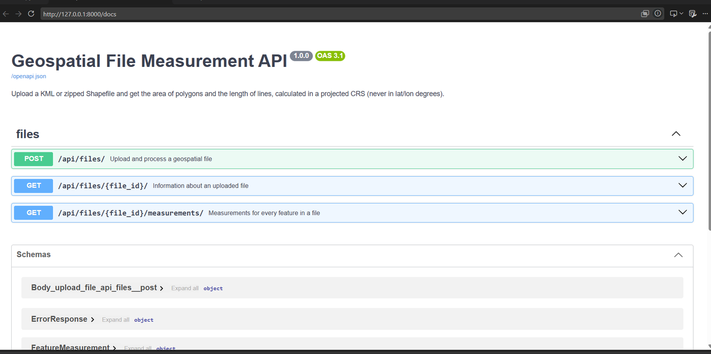
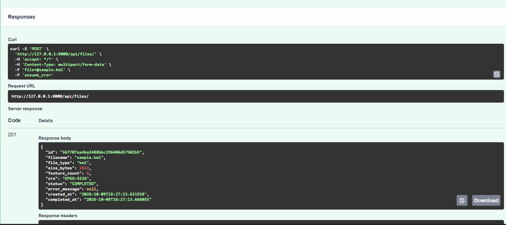
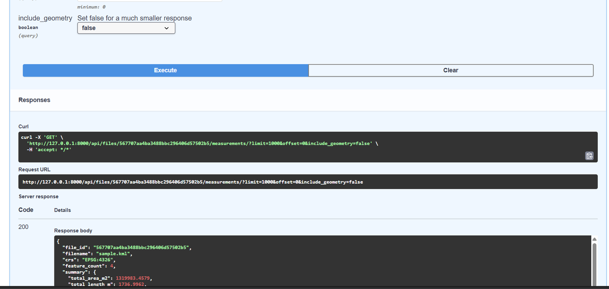
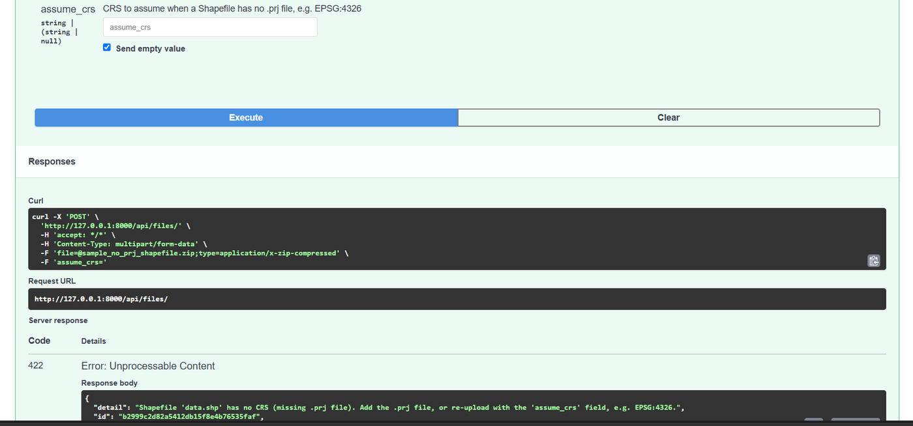
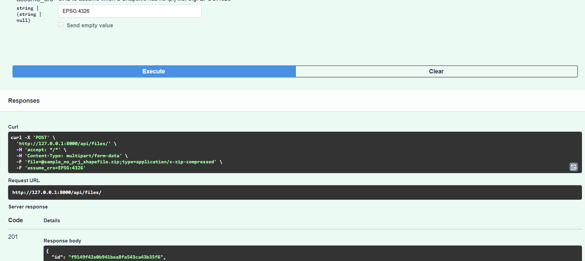
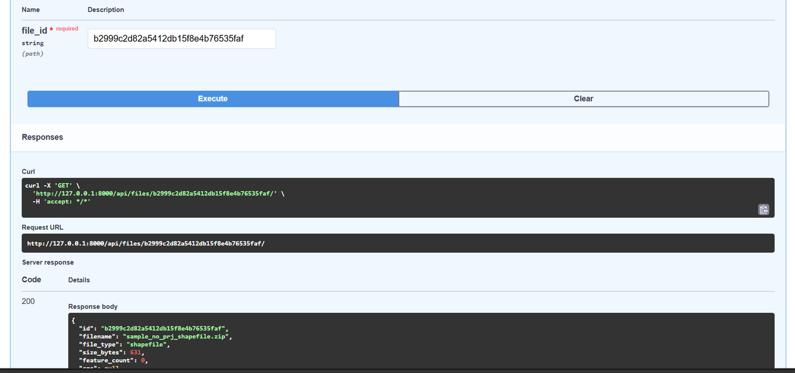
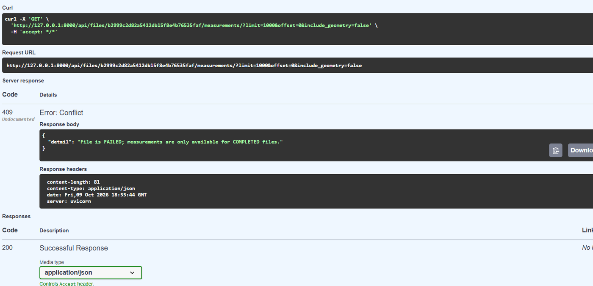

# Geospatial File Measurement API

A FastAPI backend that accepts **KML** and **zipped Shapefile** uploads, extracts every feature, and
returns the **area of polygons** and the **length of lines** in square metres and metres.

The key idea: measurements are never calculated on latitude/longitude degrees. Every geometry is
transformed to a suitable projected CRS (its UTM zone) first, and the result is cross-checked against a
geodesic calculation on the WGS 84 ellipsoid.

|            |                                                                         |
| ---------- | ----------------------------------------------------------------------- |
| Framework  | FastAPI (Python 3.10+)                                                  |
| Geospatial | geopandas, pyogrio (GDAL), shapely, pyproj                              |
| Database   | SQLAlchemy 2.0 (SQLite by default, any SQL database via `DATABASE_URL`) |
| Tests      | pytest, 46 tests                                                        |

---

## 1. Quick start

```bash
# 1. Create and activate a virtual environment
python -m venv .venv
.venv\Scripts\activate            # Windows (PowerShell / cmd)
# source .venv/bin/activate       # macOS / Linux

# 2. Install dependencies (binary wheels include GDAL, no manual GDAL install needed)
pip install -r requirements-dev.txt

# 3. Run the API
uvicorn app.main:app --reload
```

Open **http://127.0.0.1:8000/docs** for the interactive Swagger UI, where you can upload files from the browser.

Try the sample files (generated near Jaipur):

```bash
# Windows PowerShell: use curl.exe (plain "curl" is an alias for another command)
curl.exe -F "file=@sample_data/sample.kml" http://127.0.0.1:8000/api/files/
```

Recreate the sample files any time with `python scripts/make_sample_data.py`.

### Configuration (environment variables)

| Variable              | Default                  | Meaning                                         |
| --------------------- | ------------------------ | ----------------------------------------------- |
| `DATABASE_URL`        | `sqlite:///./geo_api.db` | SQLAlchemy database URL (e.g. a PostgreSQL URL) |
| `MAX_UPLOAD_MB`       | `50`                     | Largest accepted upload                         |
| `MAX_UNCOMPRESSED_MB` | `200`                    | Largest size a ZIP may expand to                |
| `MAX_ZIP_ENTRIES`     | `200`                    | Largest number of files inside a ZIP            |
| `MAX_FEATURES`        | `50000`                  | Largest number of features in one file          |

### Run the tests

```bash
pytest
```

### Screenshots of the running API

Captured from the interactive Swagger UI (`/docs`) while running the app locally with the sample files in `sample_data/`.

**1. Interactive documentation.** The three required endpoints, described automatically from the code.



**2. Upload a KML file.** `POST /api/files/` with `sample_data/sample.kml` returns `201` with status `COMPLETED`, 4 features and CRS `EPSG:4326`.



**3. Measurements.** `GET /api/files/{id}/measurements/` returns the total area (about 1,319,983 m2) and total length (about 1,737 m), calculated in a projected CRS.



**4. Missing CRS is rejected.** A Shapefile without a `.prj` file returns `422`, and the failure is stored with an id so it can be looked up later.



**5. Missing CRS fixed with `assume_crs`.** The same file uploaded with `assume_crs=EPSG:4326` returns `201`.



**6. The failed upload is stored.** `GET /api/files/{id}/` for the failed file returns `200` with the file details (0 features, no CRS) and its error message.



**7. No measurements for a failed file.** Asking for measurements of that file returns `409 Conflict`.



---

## 2. API reference

Base path: `/api/files`. Full interactive documentation: `/docs` (Swagger) and `/redoc`.

### `POST /api/files/` - upload and process a file

Multipart form fields:

| Field        | Required | Description                                                                        |
| ------------ | -------- | ---------------------------------------------------------------------------------- |
| `file`       | yes      | A `.kml` file, or a `.zip` containing a Shapefile (`.shp`, `.shx`, `.dbf`, `.prj`) |
| `assume_crs` | no       | CRS to use when a Shapefile has no `.prj`, e.g. `EPSG:4326`                        |

```bash
curl.exe -F "file=@sample_data/sample_polygons_shapefile.zip" http://127.0.0.1:8000/api/files/
curl.exe -F "file=@sample_data/sample_no_prj_shapefile.zip" -F "assume_crs=EPSG:4326" http://127.0.0.1:8000/api/files/
```

`201 Created`:

```json
{
  "id": "d7ab264fbc574a2282c010528fb17306",
  "filename": "sample.kml",
  "file_type": "kml",
  "size_bytes": 1812,
  "feature_count": 4,
  "crs": "EPSG:4326",
  "status": "COMPLETED",
  "error_message": null,
  "created_at": "2026-10-08T17:06:03.385106",
  "completed_at": "2026-10-08T17:06:03.438645"
}
```

### `GET /api/files/{id}/` - file information

Returns the same object as above (status is `COMPLETED` or `FAILED`; a failed file shows `error_message`).

### `GET /api/files/{id}/measurements/` - per-feature measurements

Query parameters: `limit` (1-5000, default 1000), `offset` (default 0), `include_geometry` (default `true`).

```json
{
  "file_id": "d7ab264f...",
  "filename": "sample.kml",
  "crs": "EPSG:4326",
  "feature_count": 4,
  "summary": {
    "total_area_m2": 1319983.4579,
    "total_length_m": 1736.9962,
    "geometry_type_counts": { "Polygon": 2, "LineString": 1, "Point": 1 },
    "measurement_status_counts": { "ok": 3, "not_applicable": 1 }
  },
  "limit": 1000,
  "offset": 0,
  "returned": 4,
  "features": [
    {
      "feature_id": 0,
      "layer": "sample",
      "geometry_type": "Polygon",
      "crs": "EPSG:4326",
      "properties": { "Name": "Parcel A", "kind": "plot" },
      "geometry": { "type": "Polygon", "coordinates": ["..."] },
      "measurement_status": "ok",
      "measurement": {
        "area_m2": 1099980.1746,
        "perimeter_m": 4201.4542,
        "projected_crs": "EPSG:32643",
        "geodesic_area_m2": 1100686.9612
      },
      "message": null
    }
  ]
}
```

- **Polygon / MultiPolygon:** `area_m2`, `perimeter_m`, `geodesic_area_m2`, `projected_crs`
- **LineString / MultiLineString:** `length_m`, `geodesic_length_m`, `projected_crs`
- **Point / MultiPoint:** `measurement_status = "not_applicable"`, `measurement = null`
- **Anything else** (empty, GeometryCollection): `unsupported` with a `message`; a failure on one feature gives `error` and never breaks the rest of the file
- `geometry` is GeoJSON in the file's **original** CRS

### Status codes

| Code | When                                                                                            | Stored?                     |
| ---- | ----------------------------------------------------------------------------------------------- | --------------------------- |
| 201  | File processed                                                                                  | yes (`COMPLETED`)           |
| 400  | Empty file, corrupt ZIP, ZIP without `.shp`, unsafe ZIP paths or symlinks, invalid `assume_crs` | no                          |
| 413  | Upload, ZIP entry count or expanded size over the limit                                         | no                          |
| 415  | Not a `.kml` or `.zip`                                                                          | no                          |
| 422  | Accepted but unreadable content: malformed KML, missing CRS, no features                        | yes (`FAILED`, id returned) |
| 404  | Unknown file id                                                                                 | -                           |
| 409  | Measurements requested for a file that is not `COMPLETED`                                       | -                           |

---

## 3. Architecture

```
app/
  main.py                 FastAPI app, error handlers, startup (creates tables)
  config.py               Settings from environment variables
  database.py             SQLAlchemy engine, session dependency
  models.py               UploadedFile, Feature tables
  schemas.py              Pydantic response models (the API contract)
  api/files.py            HTTP endpoints (thin: validation + calling services)
  services/
    file_handler.py       Type detection, size limits, safe ZIP extraction
    geo_reader.py         KML / Shapefile reading (geopandas + pyogrio)
    crs.py                UTM zone selection, CRS labels
    measurements.py       Measuring one geometry (the geospatial core)
    processing.py         Orchestrates the whole flow and persists results
    errors.py             InvalidUploadError, GeoProcessingError
tests/                    46 tests (unit + end-to-end)
scripts/make_sample_data.py
sample_data/              Ready-made KML and Shapefile examples
```

Layers are kept separate on purpose: **routes** know about HTTP, **services** know about files and
geometry, and `measurements.py` knows nothing about HTTP or the database, so it is easy to unit test.

### Processing flow

```
POST /api/files/
  -> detect type (.kml / .zip)                     415 if unsupported
  -> save to temp folder in chunks, size limit     413 / 400
  -> (zip) safe extraction, find .shp              400 if unsafe or no .shp
  -> create file record  status=PROCESSING
  -> read layers (geopandas / pyogrio)             422 + FAILED record on error
  -> for each feature: measure_geometry()
  -> store features, status=COMPLETED
```

### Measurement flow (`measure_geometry`)

1. Classify: empty, point, unsupported, or measurable.
2. If a polygon is invalid (e.g. a self-intersecting "bow-tie"), repair it with `make_valid` and add a warning to `message`.
3. Transform to WGS 84 (EPSG:4326). This makes projected inputs (UTM, Web Mercator, state plane...) behave the same way.
4. Choose the UTM zone from the centre of the bounding box (`EPSG:326xx` north, `EPSG:327xx` south, UPS near the poles).
5. Transform to that UTM zone (units are metres) and measure with shapely.
6. Cross-check against a geodesic measurement on the WGS 84 ellipsoid with `pyproj.Geod`.

Example for a 0.01 x 0.01 degree square near Jaipur:

| Method                                              | Area         |
| --------------------------------------------------- | ------------ |
| Raw area in degrees (wrong)                         | 0.0001       |
| UTM 43N projected (reported as `area_m2`)           | 1,099,980 m2 |
| Geodesic on WGS 84 (reported as `geodesic_area_m2`) | 1,100,687 m2 |

The two real methods agree to about 0.06 %.

---

## 4. Design decisions and trade-offs

1. **Always measure in a projected CRS.** Degrees are not a unit of length or area: one degree of longitude is about 111 km at the equator and about 99 km at 26.9 N. The only unit-safe route is projecting first.
2. **UTM zone per feature, not per file.** A file can span several zones. Choosing the zone from each feature's own bounding box keeps distortion low. Web Mercator is deliberately avoided: it inflates areas by roughly 1.24x at this latitude (a test proves we do not fall for it).
3. **A geodesic cross-check is returned, not hidden.** It lets a client see the accuracy of the projected result, and helps for features that straddle a zone boundary.
4. **Always go through WGS 84 first.** This gives one code path for all input CRSs, including projected files.
5. **Missing CRS is an error by default.** Guessing a CRS silently produces plausible but wrong numbers. The client can opt in with `assume_crs`. KML is always WGS 84 by specification, so it never needs this.
6. **Two kinds of failure.** Problems with the _container_ (wrong type, too big, unsafe ZIP) are rejected with 4xx and nothing is stored. Problems with the _content_ (unreadable, missing CRS, empty) are stored as `FAILED` and return 422 with the file id, so the failure can be looked up with `GET /api/files/{id}/`.
7. **Per-feature error isolation.** One bad geometry returns `status: "error"` and a message; the other features are still measured.
8. **Invalid polygons are repaired, with a warning.** A bow-tie polygon has no well-defined area; `make_valid` splits it into valid parts and the response says so.
9. **Holes are subtracted in the geodesic area too.** pyproj returns signed areas that depend on ring orientation, so a polygon with a hole can silently be _added_ instead of subtracted. Rings are therefore measured one by one with `abs()`. (A test covers this.)
10. **Z values are ignored.** Areas and lengths are planar 2D measurements on the ground.
11. **Features are stored in the database.** `GET` is a fast query and the file is never parsed twice. Trade-off: storage. For heavy spatial queries PostGIS would be the next step.
12. **Synchronous processing in the upload request.** Simple, and the client gets the result immediately. Trade-off: very large files hold the request open. Status values (`PROCESSING`, `COMPLETED`, `FAILED`) are already modelled so moving to a background worker later does not change the API.
13. **Pagination and a geometry toggle.** Large files return `limit` / `offset` pages and `include_geometry=false` for small responses. The summary always covers the whole file.

### Security

- **Zip-slip:** entries with `..`, absolute paths or drive letters are rejected, and every target path is verified to stay inside the extraction folder.
- **Zip bombs:** limits on entry count and total expanded size, enforced on bytes actually written (declared sizes can be forged).
- **Symlinks** inside ZIPs are rejected; hidden files and `__MACOSX` are skipped.
- **Filenames** from the client are reduced to their base name and never used as paths.
- **Upload size limit** is enforced while streaming.

### Known limitations

- Features crossing the antimeridian (180 degrees longitude) are not handled specially.
- Continent-scale polygons exceed what a single UTM zone can represent well; use `geodesic_area_m2` for those.
- The special Norway/Svalbard UTM zone widenings are not applied.
- No authentication, rate limiting, or retention policy for stored data.
- `GeometryCollection` features are reported as unsupported, not measured part by part.

---

## 5. Testing

`pytest` runs 46 tests:

- **Zone selection:** 10 locations including both hemispheres, zone edges, `lon = 180` and the poles.
- **Measurement:** accuracy against a geodesic reference, a hand-verifiable 1000 m x 1000 m square in UTM (must equal 1,000,000 m2), MultiPolygon, MultiLineString, holes, Z values, bow-tie repair, Web Mercator input, points, empty and unsupported geometries.
- **API end to end:** KML and Shapefile uploads, multi-folder KML, mixed geometry types, missing `.prj` with and without `assume_crs`, corrupt/empty/oversized/unsafe uploads, zip-slip, unknown ids, pagination.

Each test gets its own in-memory database, so tests are independent and fast (about 2 seconds).

---

## 6. What I learned

- **Coordinate systems matter more than the code.** Reading a KML or Shapefile takes a few lines, but I learned that
  coordinates in degrees can't be turned into square metres directly. I now project to a UTM zone first and check the result against a geodesic calculation.
- **A missing CRS must not be guessed.** A Shapefile without a `.prj` file gives plausible but wrong numbers if the CRS is assumed silently,
  so the API returns 422 unless the client sends `assume_crs`.
- **Failures should be stored, not lost.** When I tested a file with no CRS, the API saved it as `FAILED` and returned an id,
  so I could look it up with `GET /api/files/{id}/`. Asking for its measurements returns 409.
- **Real testing finds bugs that tests don't.** While trying the API in Swagger I got a 404 even though the file existed.
  The id I pasted had leading spaces (`%20` in the URL). I fixed it by stripping whitespace from the id.
- **Run the app the right way.** Running `main.py` with the Run button failed with `No module named 'app'`;
  starting it with `python -m uvicorn app.main:app` works because it loads the project as a package.
- **Uploaded files are untrusted input.** ZIP files need path checks and size limits (zip-slip, zip bombs) before they are read.
- **Small, separate functions are easy to test.** `measure_geometry` has no HTTP or database code, so I could test it quickly with known shapes.

## 7. Future scope

- **Background processing** with a task queue (Celery, RQ or ARQ) and status polling for large files; the status model already supports it.
- **PostGIS** storage to allow spatial queries (intersects, within a bounding box) and vector tile output.
- **More formats:** GeoJSON, GeoPackage, GPX, DXF; **more measures:** centroid, bounding box, perimeter of lines' closed rings.
- **Better accuracy options:** choose between UTM, a local equal-area projection, or geodesic as the primary method per request.
- **Antimeridian and polar handling**, and splitting multi-zone features.
- **Authentication, rate limiting, and retention rules** for uploaded data.
- **Alembic migrations**, Docker image, and a GitHub Actions workflow that runs the tests.
- **Observability:** structured logs, request ids and metrics.
